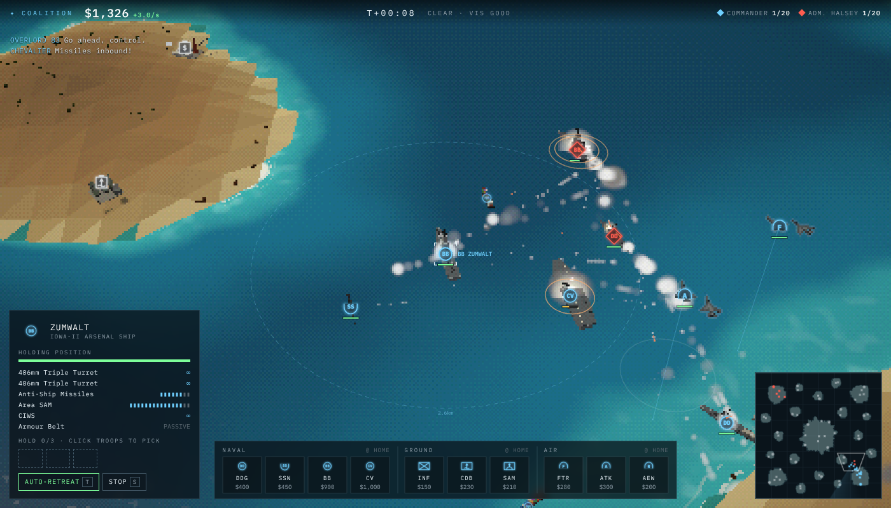
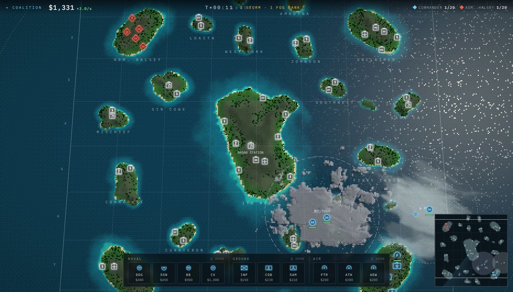
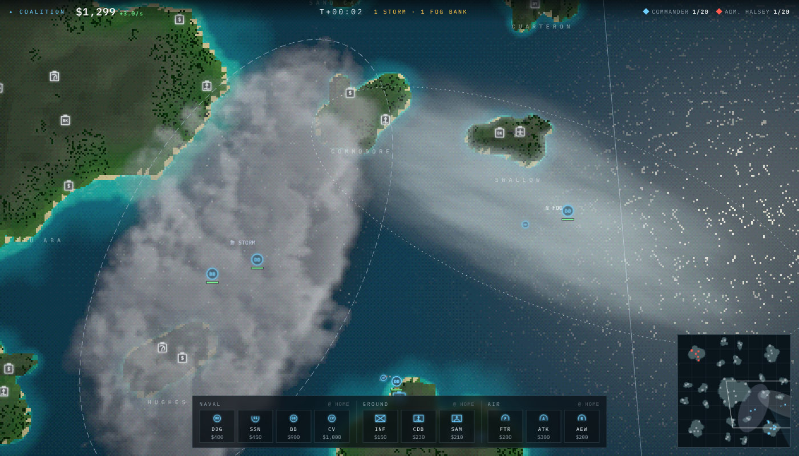
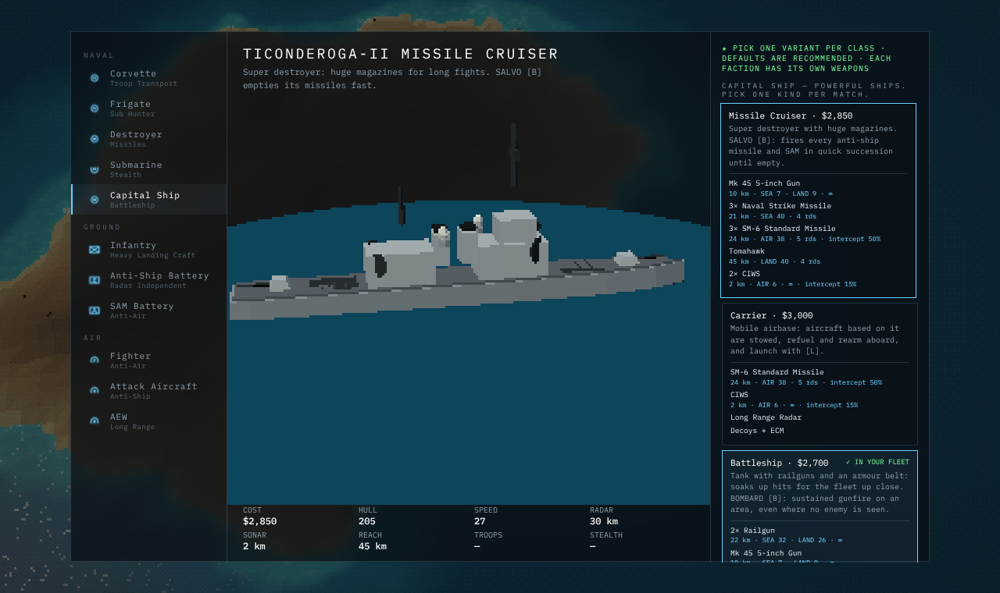

# Salvo Conquest

A minimalist,a multiplayer, browser-based RTS about near-future littoral combat in an archipelago.
It mixes a casual take on *Sea Power* naval warfare with *WARNO*-style ground and air support,
drawn as pixelated low-poly 3D under a crisp NATO-symbol overlay.



- **Runs on one Cloudflare Worker.** Static client from Workers Static Assets, one Durable Object per room runs the authoritative simulation.
- **Play offline vs AI** in the browser (the same simulation runs locally), or **create a room** and send the link to friends.
- **Online lobby:** every commander picks their own **team** (1–4; same team = allies, who start on neighbouring
  home islands) and an **income handicap** (100% down to 30% of normal HQ and merchant income). The host can add AI
  commanders and set each one's faction (⇄), team and handicap, or reset all teams with *All vs all* / *2 v 2*. The
  game needs at least two teams to start.
- **Reconnects by itself.** A refresh, a dropped or silent connection, or a tab that comes back from the background
  puts you back in your seat in the running game (each browser tab has its own reconnect token). The client retries
  for up to 2 minutes. A redeploy of the Worker restarts every room, and a game in progress is lost.

## How to play

| Input | Action |
| --- | --- |
| LMB / drag | Select / box select · double-click selects all of a type |
| RMB | Move · attack (on enemy or radar contact) · board (troops on a ship) · escort (ships or aircraft on a friendly ship or aircraft: they follow it and fight off what comes near) |
| Ctrl + RMB | Move without stopping to fight |
| WASD / MMB drag / screen edge | Pan · Q/E rotate · wheel zoom |
| U | Unload troops: a ring shows the landing range, click land inside it (every selected ship with troops lands there) |
| F / C / G / M / R / T / X | Fire control (hold fire → weapons tight → weapons free) · chaff or smoke · radar on/off · drop mines, a sonobuoy or a minefield · aircraft return to base · toggle auto-retreat · stop |
| B | Missile cruiser: **SALVO** (every anti-ship missile and SAM goes out in quick succession) · battleship: **BOMBARD** (then click an area: 45 s of gunfire on it) |
| Ctrl+1–9 / 1–9 | Save / recall group (press twice to jump the camera) |
| Tab / V | Show weapon ranges / sensor view (darkens what you cannot see) |
| Space · Enter · F1 · Esc | Jump to last alert · chat (online) · field manual · menu |

**Goal:** capture the enemy **HQ**, or hold 75% of all resource sites for 3 minutes.

- Each player starts on a home island with an HQ, a naval base, an airbase and barracks, and no units.
- **Deployment phase** (like WARNO): the clock stands still for up to 2 minutes while you buy your opening
  force from the build bar and place it inside your deployment zone (ships on open water, troops on the home
  island, aircraft anywhere in the zone). Right-click moves placed units, troops can embark on ships, Del refunds.
  The budget is **32 points ($4,800)**. Money you don't spend carries into the battle. The battle starts when
  every player presses **Launch battle** (or the timer runs out).
- **Prices** follow fixed ratios of one point = $150, then each unit type has its own fixed markup of 4–9%
  (`PRICE_MARKUP` in `src/shared/defs.ts`):

  | Naval | Points | Price | Air | Points | Price | Ground | Points | Price |
  |---|---|---|---|---|---|---|---|---|
  | Corvette | 2 | $320 | Fighter | 2 | $325 | Infantry | 1 | $155 |
  | Frigate | 4 | $625 | Attack | 3 | $470 | Anti-ship battery | 2 | $320 |
  | Submarine | 4 | $650 | AEW | 3 | $470 | SAM battery | 2 | $325 |
  | Destroyer | 8 | $1,260 | | | | | | |
  | Cruiser / carrier / battleship | 18 | $2,820 / $2,875 / $2,870 | | | | | | |

- **Income** is slow, so every merchant counts: the HQ earns $4.50/s, and a merchant earns $67.50 plus $13.50 per km
  of its trip (about $470 for a 30 km run).

- **Building:** pick a unit in the build bar, then click the map where it should go (Shift: place several). A ghost
  shows which building will make it (the nearest one that can reach the spot) and stays there until the unit is
  built; then the unit moves out to that spot. Ships can only go to water connected to one of your naval bases or
  dockyards, troops only to an island with one of your barracks; aircraft can be sent anywhere.
- Units are expensive (prices ×3): forces are small and every hull counts. Ships carry few missiles
  (destroyer: 4 anti-ship missiles; 5 SM-6 or 6 HQ-9B SAMs per launcher) and rearm at a naval base or dockyard (ground units at any friendly building), but only after a lull: no hit
  for 30 s, no shots fired for 20 s, and nothing homing on them. Field medics and launcher reloads wait too. Missile batteries (buildings and trucks) fire at half their old rate.
- Ground units capture buildings by standing next to them. Captured **resource sites** spawn merchant
  ships that sail cargo home and turn it into cash. They unload only at a naval base (your own or a captured one)
  or a port on your home island, never at a forward dockyard. Enemy subs love merchants. When a merchant is sunk,
  its site waits 45 s before it sends the next one.
- Other buildings give bonuses: radar stations (24 km air / 18 km surface radar), airbases, barracks and dockyards (forward production, repair, rearm),
  missile batteries (fire for whoever owns them).
- Only **corvettes** carry troops (2, the Troop Transport 4, the Swarm 1). Carriers carry air flights instead (Coalition 5, Union 4): right-click a carrier with aircraft selected to base them there. Flights that land are stowed on deck (not drawn on the map); select the carrier and press **LAUNCH** (**L**), then click the area: fighters fly CAP there, strike flights hunt there, AEW orbits there. The dashed ring shows the strike radius. Aircraft are built at airbases only.
- **Airbases** base aircraft the same way, with twice a carrier's slots (Coalition 10, Union 8): right-click your
  airbase with aircraft selected and they land there and stay. Click the airbase (or a flight parked on it) to see its
  air wing, then press **LAUNCH** (**L**) and click the area to send every parked flight there in one wave. New
  aircraft are based where they are built, or at the nearest base with room.
  RMB a ship with troops selected and they walk to the shore and ride landing craft out to it.
- **Ship damage** (like WARNO tank combat): hits can knock out systems, not just hull points. An **engine** hit
  stops the ship dead for 8 s, then leaves it at 55% speed; **steering** jams (quarter turn rate), **radar** drops
  to 35% range, a **weapon** mount goes silent, **fires** and **flooding** keep hurting, and heavy hits **stun** the
  crew (no firing for a few seconds). Torpedoes and mines flood and wreck engines; shells hit mounts; missiles start
  fires. Systems repair over time, three times faster at a friendly naval base. Damaged systems show as tags under
  the unit (DIW, RUD, RAD, WPN, FIRE, FLD, STUN) and in the selection panel with the seconds left.
- **Targeting:** every weapon picks the most dangerous target it can reach (battleships, destroyers and subs
  first, then attack aircraft, carriers and coastal batteries, merchants last); distance and damage only break
  ties. Torpedoes listen for a target all the way (not only at their aim point), lead a moving ship, and turn
  tightly enough to finish an attack run.
- **Fire control (F):** each unit is on **weapons tight** by default. The limit counts your whole side (ships,
  batteries and aircraft together): at most two guided rounds (missiles, torpedoes, SAMs) in flight at one
  target, and at one incoming missile two SAMs at a time and four in all (if the first pair misses, one more
  pair). Units also hold fire when the target is already as good as dead. A unit on **weapons free** ignores
  the limit: it fires everything that bears, as fast as the launchers reload (up to four SAMs at a time at one
  target). **Hold fire** stops all shooting except self-defence against incoming missiles (SAMs and CIWS).
  The computer opponent goes weapons free against capital ships, and against any warship when its group clearly
  outguns the enemy there. The selection panel shows each unit's
  **kills** (top right).
- **Countermeasures (C):** every warship and air flight carries one load of **chaff**, every ground unit one load of
  **smoke**. Chaff throws a cloud of foil that pulls each enemy missile or SAM homing on the unit off course
  (60% chance each, 40% for hypersonic missiles), while the unit stays within 2.5 km of the cloud (8 s). Smoke hides
  ground units inside it from everything further than 350 m, makes shots already on the way hit less than half as
  often, and keeps laying more smoke behind the unit for 12 s so it can run. Loads refill when the unit rearms.
- **Dodging heat-seekers:** aircraft out-turn short-range heat-seeking missiles (dogfight AAMs, MANPADS) on their
  own, no button needed: fighters dodge 40% of the shots that would hit, strike aircraft 30%, AEW 15%.
  Radar-guided missiles (SAMs, long-range AAMs) are not dodged this way; ECM works against those.
- **Computer opponents** use only what their side detects. They focus fire by class matchup (frigates on
  subs, battleships and cruisers on destroyers), keep carriers behind the screen, pull capital ships away from known subs,
  send subs after capital ships and merchant lanes while dodging frigates, carry troops in corvettes,
  shell landing beaches with battleships, fire cruiser salvos at capital ships, strike only lightly
  defended ships, cover raided merchant lanes with fighters, seed sonobuoys from the AEW, ferry troops from
  any island they hold, and counter-build what they see.
- **Map:** 160 × 160 km. Every home gets the same mix of neutral islands (one quarter's layout is copied, rotated, to
  all four quarters, then each copy is nudged a few km and gets its own shape and size, so the map stays a little
  asymmetrical): one building island 18–24 km off each home, one dockyard per quarter. Islands keep their size, so there is far more open water between them; merchants
  are paid by trip length, so far islands pay more per trip.
- **Automation:** ground units attack-move by default, idle troops engage enemies on their island, damaged units
  retreat to friendly buildings and come back when repaired, warships whose missiles, SAMs and torpedoes are all
  spent sail to the nearest naval base or dockyard, rearm and return to their task (both follow the auto-retreat
  toggle, T), aircraft fly their mission, return to rearm and
  go back on station. Ships close the distance on their own when you order an unload out of range.

### Ship counters

The navy works as a rock-paper-scissors triangle. Each counter wins its 1-vs-1 duel clearly (30 duels per pair,
both factions, default variants): frigate beats submarine 55–5 (60 duels, after the sonar cut), submarine beats battleship 30–0 and cruiser
30–0, battleship beats destroyer 23–5 (2 draws), destroyer beats frigate 30–0.

| Ship | Beats | Loses to | Why |
|---|---|---|---|
| Submarine ($650) | Capital ships | Frigate | Passive sonar hears ships at 1.3× its sonar range, so it finds them first and stays hidden. Heavy torpedoes explode under the keel: ×1.6 damage to battleships, cruisers and carriers. Destroyers and capital ships are deaf or nearly deaf to subs and have no anti-sub weapons. |
| Frigate ($625) | Submarine | Destroyer | The only surface ship with sonar (12–13 km; the Sub Hunter's towed array adds 40%, to about 17–18 km) and ASW rockets that reach 11–12 km, further than a sub's torpedoes. Towed torpedo decoys halve torpedo hits. |
| Destroyer ($1,260) | Frigates, corvettes | Battleship, cruiser | The main fighter: the most firepower for the price. No sonar. |
| Battleship ($2,870) | Destroyer | Submarine | Railguns, a thick armoured hull and its own air defence. |

Escort capital ships with frigates. Hunt destroyers with battleships, cruisers and aircraft. Corvettes carry the
troops: keep them behind the warships until the beach is clear.

### Sensors and fog of war



Radar (surface and air), sonar and eyesight. Sonar is the only way to find submarines; passive sonar also hears
surface ships (a submarine far better than a noisy surface ship). Far-away or poor-quality detections show as a
**radar contact**: one calm marker per track, placed somewhere within the error radius of the true position (the
error shows on hover). As you close in, the estimate glides toward the truth until the contact becomes an identified
track. **Unidentified contacts cannot be targeted**: they mark a position only (right-click there is a move);
once a contact is classified you can attack it. Ground contacts use a square marker, surface contacts a quatrefoil.
The minimap outlines your sensor coverage (surface radar and eyes, air radar, sonar). On the main map, water and land
outside your surface picture are always shaded with a light, hatched veil, with a thin line where coverage ends. Press
**V** (or the SENSORS button above the minimap) for the full sensor view: everything your sensors cannot see goes dark. At most two weather systems are on the map at once. Storms cut radar range and eyesight; fog banks cut eyesight. Inside a storm (at full strength) ships move and turn 40% slower, aircraft fly 25% slower and burn fuel twice as fast, troops move at half speed, guns and bombs fired from the storm are 35% less accurate (missiles 10%), and anything in it is 25% harder to hit. Submarines do not feel it. The coverage lines and the veil show this: where a storm or fog bank sits in your coverage, the covered area has a bite taken out of it. Sonar is not affected. Submarines are
invisible until a sonar hears them, and they reveal themselves briefly when they fire.

**What the coverage lines mean** (minimap and the V view): **blue** is your surface picture (surface radar
and eyesight: where ships and, closer in, ground units are seen); **white** is air-search radar that reaches
beyond it (aircraft and missiles only); **purple** is sonar (the only way to find submarines), including your
sonobuoys.

**Why something inside your radar ring can be unidentified.** The ring is the radar's range against a
standard target. Each contact gets a quality from 0 (at the edge) to 1 (on top of you): 1 − distance ÷ range.
The range is scaled by the target: ships by their radar signature (a stealthy Coalition destroyer is seen
later than a large Union one), ground units at 45%, aircraft by their stealth (0.6× to 1.4×), and storms cut it.
A contact becomes **identified** (and can be targeted) only above quality 0.4, that is, inside about 60% of
that scaled range; it becomes an exact track (error radius 0) closer still, or at once within eyesight
(about 6 km). So a 15 km surface radar identifies a typical destroyer at about 9 km. Aircraft (AEW), sonobuoys
and more ships close to the target raise the quality.

**Sonobuoys (M).** The Sonobuoys AEW carries 8 sonobuoys. Press M to drop one below it (only over water). Each buoy
listens for 150 s: it hears submarines within 6 km, and ships further away, and shows as a small purple ring.

**Markers.** Every contact is drawn where the unit really is; the quality of the track only decides whether it is
identified (and can be targeted). A contact our sensors lose disappears after 1.5 s and leaves a faint
last-known-position marker for 8 s. A unit we only **hear** (its radar is on, none of our sensors sees it) is shown
as a small pulsing **ESM** emitter mark, not a track symbol: it stays as long as its radar stays on, even after it
leaves your radar range or you switch your own radar off, and it cannot be targeted.

**Radar on/off (G).** Every unit with a radar (warships, AEW, radar trucks) can switch it off. Radar on: you see
far, but enemy electronic support measures (ESM) hear your radar out to 1.5× its range and get a rough,
unidentified position for you (marker only, cannot be targeted). Radar off (tag **DARK**): your unit sees only by
eye (about 6 km) and sonar, and cannot be heard; your team's other sensors still feed it targets. When an enemy
radar is tracking one of your units, a thin amber arc appears on its marker on the side the radar is painting
from, with a faint glint sweeping along it (like a radar-warning receiver), and the selection panel shows
**RADAR LOCK** with the compass bearing to that radar.



### Factions

Both sides pay the same price and build time for each unit. There are no special abilities: the factions differ
in **hull stats** and in **which weapons they can fit** (each side has its own missiles, SAMs, guns and torpedoes;
utility kit such as CIWS, ECM, mines, sonar and armour is shared). See `HULLS` and `MODULES` in `src/shared/defs.ts`.
Speeds in the table are listed speeds; every unit moves 20% faster than listed (`MOVE_SPEED` in `defs.ts`), and
aircraft 10% faster again (`AIR_SPEED`).
Weapons (missiles, torpedoes, shells) keep their own speeds.

| Unit | Atlantic Coalition (US pattern) | Pacific Union (PLAN / Russian pattern) |
|---|---|---|
| Corvette | Freedom LCS: hull 58, fastest (0.42), stealthier (0.6). Swarm: NSM quad packs (16 km) | Type 056: hull 66, slower. Swarm: YJ-83 quad packs (16 km, harder to intercept) |
| Frigate | Constellation: hull 78, sonar 13 km, ESSM (14 km), VL-ASROC (12 km) | Type 054B: hull 86, sonar 12 km, HQ-16 (15 km), CY-5 ASW (11 km) |
| Destroyer | Hull 100, air radar 24 km, radar signature 1.0. Mk 45 5-inch (10 km), **NSM** (21 km, stealthy: 30% harder to intercept), **SM-6** (24 km, best interceptor, 5 rounds) | Hull 102, air radar 22 km, signature 1.15. 130mm gun (12 km), **YJ-18** (22 km, supersonic sprint: 25% harder to intercept), **HQ-9B** (20 km, 6 rounds) |
| Missile cruiser | Ticonderoga-II: hull 205, radar 30 km, 3× NSM, 3× SM-6, Tomahawk | Type 60 (Kirov-type): hull 225, heavy anti-ship missiles (25 km), 2× YJ-18, 3× HQ-9B, CJ-10 |
| Submarine | Hull 70, quieter hull (noise 80%), sonar 12 km. Mk 48 ADCAP (10 km, wide seeker), Sub Harpoon (17 km) | Hull 75, faster (0.28), sonar 10 km. Yu-6 (9.5 km, bigger warhead), sub-launched YJ-18 (18 km, supersonic) |
| Battleship | Iowa-II: hull 265 (+35% armour), two **railguns** (22 km, never run dry), Mk 45, SM-6 | Type 70: hull 240, faster. Two **Type-726 railguns** (21 km), 130mm gun, HQ-9B |
| Carrier | Ford: hull 210, **5 flights** on deck, SM-6 | Hull 200, 4 flights, bigger radar (32 km), HQ-9B |
| Infantry | ACV: hull 60, faster, Javelin (stronger) | ZBD-05: hull 70, slower, HJ-12 (longer reach) |
| Coastal / SAM | NMESIS (NSM, 20 km, stealthy), Patriot PAC-3 (16 km, best vs missiles) | YJ-12 (22 km, supersonic, bigger warhead), HQ-9 (20 km) |
| Fighter | F-22: stealthiest (signature 0.3), faster, AIM-120D (16 km, accurate) | J-20: signature 0.4, PL-15 (20 km, less accurate) |
| Strike | F-35: stealthy (0.35), JSM (12 km, stealthy), guided bombs | J-15: tougher (36), less stealthy (0.7), shorter range, two YJ-83K (17 km) and KD-88 |

Aircraft stealth is real in the sim: radar sees a stealthy jet at down to 0.6× its normal range.

Each side has its own models, after real equipment of the type:

| Unit | Coalition | Union |
|---|---|---|
| Corvette | Freedom LCS (tall slab superstructure, big flight deck) | Type 056 (compact superstructure, missile boxes) |
| Frigate | Constellation (three SPY-6 faces, one funnel) | Type 054B (integrated mast, twin uptakes) |
| Destroyer | Arleigh Burke (four SPY-1 faces, two funnels) | Type 055 (integrated mast, one funnel) |
| Missile cruiser | Ticonderoga (two deckhouses, VLS fore and aft) | Kirov-type strike cruiser (missile hatch grid) |
| Submarine | Virginia (pump-jet, no sail planes) | Type 09x (hull hump, sail planes, X tail) |
| Battleship | Iowa (three triple turrets) | Railgun battleship (enclosed twin turrets, integrated mast) |
| Carrier | Ford (catapults, small island aft) | Ski-jump carrier (big island amidships) |
| Infantry | ACV 8x8, theatre camouflage | ZBD-05 tracked amphibious IFV, blue-grey camouflage |
| Coastal / SAM | NMESIS, Patriot | YJ-12 TEL, HQ-9 (upright tubes) |
| Aircraft | F-22, F-35, E-2 Hawkeye | J-20 (canards), J-15 (Flanker), KJ-600 |

Every model comes in three versions, one per variant: the kit shows on deck (extra launchers, a second gun,
mine rails, a missile hump on the sub, drop tanks under the wings...).

### Fleet comp



Before a match, open **Fleet Comp** from the menu and pick one of three variants for every class (per faction).
Your build bar then has one button per class; every unit of that class is built as the variant you picked. The
capital class is a choice of ship: you build cruisers, carriers **or** battleships in a match. The defaults
(★) are the recommended picks. Computer players pick their own.

| Class | Variants |
|---|---|
| **Corvette** (carries troops, good in swarms) | **Troop Transport**: 4 troops, smoke screen [C] that also hides ships, almost unarmed · **Littoral Combat Ship**: 57 mm + 76 mm guns and CIWS against troops and boats near the shore, 2 troops · **Swarm**: two anti-ship missile quad packs, 1 troop |
| **Frigate** (hunts subs, lays mines) | **Sub Hunter**: towed sonar, two ASW launchers, torpedo tubes, drops a sonobuoy every 4 km it sails · **Mine Layer**: 3 loads of mines [M] instead of 1 · **Air Defence**: two extra SAM launchers |
| **Destroyer** (main fighter) | **Missiles**: two anti-ship launchers · **Air Defence**: two long-range SAM launchers · **Guns**: two main guns |
| **Submarine** (assassin) | **Stealth**: 15% slower, much quieter · **Mines**: lays 2 loads of mines [M] · **Long Range**: half its torpedoes swapped for anti-ship missiles |
| **Capital ship** | **Missile Cruiser**: huge magazines; SALVO [B] fires every anti-ship missile and SAM in quick succession until empty · **Carrier**: as before · **Battleship**: railguns and armour to soak up hits up close; BOMBARD [B]: 45 s of gunfire on an area (rounds burst over 0.45 km and hurt everything hostile on the surface, seen or not) |
| **Infantry** | **Heavy Landing Craft**: armoured landing craft with 3× the hull · **Heavy APCs**: autocannon and mortars against troops · **Sappers**: dig in (−30% damage while holding) and lay one minefield [M] |
| **Anti-ship battery** | **Short Range**: 14 km, 8 missiles · **Long Range**: 27 km, 2 missiles (both need outside radar) · **Radar Independent**: brings its own radar truck |
| **SAM battery** | **Missile Defence**: 10 km, 12 rounds, better interceptor · **Anti-Air**: 25% more reach, 5 rounds · **AA Guns**: never run out, 3.5 km, inaccurate |
| **Fighter** | **Anti-Missile**: 9 km missiles, 4 of them, that also shoot down anti-ship missiles · **Anti-Air**: longer reach, more accurate, 1 round · **SAM Screen**: counter-SAM missiles (10 km, 6 rounds) that shoot down enemy SAMs and air-to-air missiles chasing your missiles or aircraft; escort a strike flight with it, or fly it over a missile barrage |
| **Attack aircraft** | **Anti-Ship**: heavy anti-ship missiles · **Anti-Ground**: stand-off missiles and guided bombs · **Anti-Sub**: two loads of ASW torpedoes |
| **AEW** | **Long Endurance**: drop tanks · **Long Range**: 46 km air / 38 km surface radar · **Sonobuoys**: drops listening buoys [M] |

Variants are defined in `CLASSES` in `src/shared/defs.ts`.

### Computer opponent

The AI (`src/shared/ai.ts`) plans in islands. It gives each island a value (resource sites count most, the
middle island gets a bonus) and estimates the enemy strength there from what its sensors have seen. If it has
not seen the defenders of an enemy island, it assumes that there is a garrison.

1. **Money first.** Single transports take open islands near the waiting troops: resource islands first, then
   a stake in the middle island.
2. **Spend everything, navy first.** The AI walks one build list every 2 s and buys the first item it still
   lacks: a transport and a landing party, a second transport, the troops for the next landing, a frigate (more
   when it has seen submarines), a submarine for the merchant lanes, destroyers, a strike flight, fighters
   against enemy strike flights, more destroyers, and a capital ship only after three destroyers. When the next
   warship costs more than it has, it saves for it. It does not keep idle troops or spare batteries.
3. **Planned landings.** The AI attacks an enemy-held or contested island only when its fleet is at least 1.4×
   the threat there. The troops board on one island while the escorts gather. The fleet sails ahead and the
   transports follow. The troops land when the transports are off the island and the sea there is clear. The
   escorts stay until the island is taken.
4. **Back off and regroup.** If the force falls below 40% of its starting strength, or the enemy near it becomes
   stronger, the whole force goes back to port. It does not start new fights on the way. The AI does not attack
   that island again for 4 minutes. While a landing is under way, every new healthy warship joins it.
5. **Attack where stronger.** Warships that are not on a landing go after enemy squadrons that they outgun, or
   wait on the enemy's merchant lanes off their resource islands. Strike flights with nothing to support hunt
   merchants on lanes without enemy warships. Landing craft and transports near the AI's islands are the
   first targets of its ships and aircraft.

### Theatres

- **Operation Sandglass:** desert, Strait of Hormuz / Eastern Mediterranean
- **Operation Monsoon:** jungle, Spratly Islands / South China Sea (frequent storms)
- **Operation Williwaw:** arctic, Aleutian Islands (frequent fog)

## Voice lines (record your friends!)

Put audio files in `public/audio/voice/` and rebuild. Every line gets a radio filter with squelch clicks.

```
public/audio/voice/<category>/<event>_<n>.mp3            # e.g. naval/select_1.mp3
public/audio/voice/<faction>/<category>/<event>_<n>.mp3  # optional per-faction override (coalition|union)
```

Categories: `naval`, `ground`, `air`. Events and suggested lines are listed in
[`public/audio/voice/README.md`](public/audio/voice/README.md). `npm run build` generates `manifest.json`.
Lines without recordings appear as subtitles in the radio log.

**Pilots.** Each air flight gets one of four pilots, picked from its unit id (random per flight, never changes, the
same for every player): Dallas, Eagle 1, Leftwing or Spitball. The pilot's callsign shows in the flight's panel and
signs its radio lines. Each pilot has five recordings in `public/audio/voice/air/pilots/<pilot>/`:

| file | plays when |
| --- | --- |
| `reporting` | the flight is built or selected |
| `affirmative` | the flight gets an order (move, attack, RTB, base) |
| `spotted` | a new enemy appears within 25 km of the flight (at most every 25 s) |
| `damage` | the flight loses hull (at most every 15 s per flight) |
| `death` | the flight is shot down |

Use MP3 for new recordings: every browser decodes it. AAC (`.m4a`) fails in some Chromium builds.

## Development

```bash
npm install
npm run dev        # client only at http://localhost:5173 (skirmish vs AI works)
npm run local      # wrangler dev (builds first): full game incl. online rooms at http://localhost:8787
npm test           # headless bot-vs-bot simulation on all three maps
npm run typecheck
npm run bench:ai   # many short headless AI games in parallel (no full playthrough needed)
```

`bench:ai` plays bot games on all cores (a 20-minute game takes about 10 s) and prints the averages every few
minutes: islands, resource sites, middle-island sites, ships, idle troops, and planned landings started, won and
called off. Settings: `GAMES` (default 8), `MIN` (game length, default 20), `CHECK` (minutes between rows,
default 5). `VS=<git revision>` plays the current AI against the AI at that revision, with sides and factions
swapped so that map and faction luck cancel out. It also prints the mean score margin with a 95% interval.
Single games vary a lot: two identical AIs can split 11 to 21 in 32 games, so use 96 games to decide:

```bash
VS=HEAD GAMES=96 MIN=25 npm run bench:ai   # did my change make the AI better?
```

## Deploy to Cloudflare from GitHub

**Option A: Workers Builds (no secrets in GitHub).**
In the Cloudflare dashboard, go to *Workers & Pages → Create → Import a repository* and pick this repo.
Keep the default settings:

- Build command: *(empty)*. Do **not** use `npm run dev` or `npm run local`: they start a server that never exits, so the build never finishes.
- Deploy command: `npx wrangler deploy`. It runs `npm run build` itself (see `build` in `wrangler.jsonc`).
- Production branch: the branch you push to.

Every push to the production branch then builds and deploys.
See [Workers Builds](https://developers.cloudflare.com/workers/ci-cd/builds/).

**Option B: GitHub Actions.** `.github/workflows/deploy.yml` typechecks, runs the simulation test, builds and deploys on
every push to `main`. It is off by default so it does not clash with Option A. To use it:

1. Add repository secrets `CLOUDFLARE_API_TOKEN` (template "Edit Cloudflare Workers") and `CLOUDFLARE_ACCOUNT_ID`.
2. Add the repository variable `DEPLOY_WITH_ACTIONS` = `true`.

Durable Objects with the SQLite storage backend are available on the Workers Free plan
([docs](https://developers.cloudflare.com/durable-objects/platform/pricing/)). The room loop uses about 1–3 ms of CPU per
100 ms tick. Clients ping every 2 s, which keeps each Durable Object event well inside the default CPU limit.

## Architecture

```
src/shared/   simulation (runs on the server and in the browser)
  defs.ts       units, modules (weapons/utilities), buildings, factions
  map.ts        procedural 4-fold-symmetric archipelago, nav grid, A* pathfinding
  game.ts       authoritative sim: movement, sensors + fuzzy contacts, combat, capture, economy, transport, weather
  ai.ts         computer opponent
  protocol.ts   messages and compact snapshots
src/server/   Cloudflare Worker + GameRoom Durable Object (lobby, 10 Hz loop, per-player fog-of-war snapshots)
src/client/   Three.js renderer (low-res pass + depth outlines + dither), NATO overlay, HUD, menus, WebAudio synth
```

Fog of war is resolved on the server: clients only receive what their team can detect.
