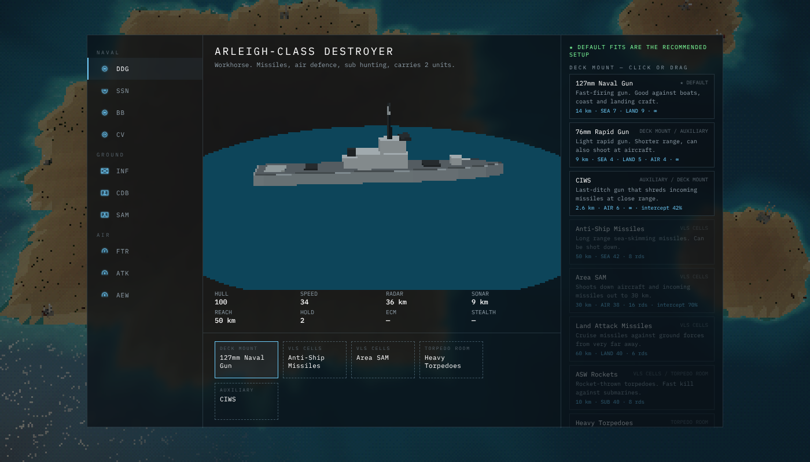

# Salvo Conquest

A minimalist, multiplayer, browser-based RTS about near-future littoral combat in an archipelago.
It mixes a casual take on *Sea Power* naval warfare with *WARNO*-style ground and air support,
drawn as pixelated low-poly 3D under a crisp NATO-symbol overlay.


- **Runs on one Cloudflare Worker.** Static client from Workers Static Assets, one Durable Object per room runs the authoritative simulation.
- **Play offline vs AI** in the browser (the same simulation runs locally), or **create a room** and send the link to friends.

## How to play

| Input | Action |
| --- | --- |
| LMB / drag | Select / box select · double-click selects all of a type |
| RMB | Move · attack (on enemy or radar contact) · board (troops on a ship) |
| Ctrl + RMB | Move without stopping to fight |
| WASD / MMB drag / screen edge | Pan · Q/E rotate · wheel zoom |
| U | Unload troops: a ring shows the landing range, click land inside it |
| M / R / T / S | Drop mines · aircraft return to base · toggle auto-retreat · stop |
| Ctrl+1–9 / 1–9 | Save / recall group (press twice to jump the camera) |
| Tab / V | Show weapon ranges / toggle radar and sonar coverage |
| Space · Enter · F1 · Esc | Jump to last alert · chat (online) · field manual · menu |

**Goal:** capture the enemy **HQ**, or hold 75% of all resource sites for 3 minutes.

- Each player starts on a home island with an HQ, a naval base, an airbase and barracks.
- Ground units capture buildings by standing next to them. Captured **resource sites** spawn merchant
  ships that sail cargo home and turn it into cash. Enemy subs love merchants.
- Other buildings give bonuses: radar stations (huge radar bubble), airbases, barracks and dockyards (forward production, repair, rearm),
  missile batteries (fire for whoever owns them).
- Ships carry troops (destroyer 2, battleship 3, carrier 4; a Troop Bay module adds 2).
  RMB a ship with troops selected and they walk to the shore and ride landing craft out to it.
- **Automation:** ground units attack-move by default, idle troops engage enemies on their island, damaged units
  retreat to friendly buildings and come back when repaired, aircraft fly their mission, return to rearm and
  go back on station. Ships close the distance on their own when you order an unload out of range.

### Sensors and fog of war


Radar (surface and air), sonar (submarines only) and eyesight. Far-away or poor-quality detections show as a
**radar contact**: a marker at a *random point* within the error radius of the true position, with a dashed ring
showing where the real unit could be. Each new radar sweep picks a new point; as you close in, the ring shrinks until
the contact becomes an identified track. Storms cut radar range and eyesight; fog banks cut eyesight. Submarines are
invisible until a sonar hears them, and they reveal themselves briefly when they fire.

### Factions

- **Atlantic Coalition** (NATO-like): expensive, tougher hulls, better sensors and damage.
- **Pacific Union** (PRC-like): hulls cost 35% less and build ~22% faster, but are weaker.

### Loadouts



Every unit has slots (deck mount, VLS, torpedo room, auxiliary, hardpoints, pods, arms, kit). Open **Loadouts** from the
menu and drag modules into slots: e.g. give destroyers **Mine Rails**, swap a VLS for land-attack missiles, add a Troop Bay,
or put sonobuoys on the AEW. The defaults are the recommended fit.

### Theatres

- **Operation Sandglass:** desert, Strait of Hormuz / Eastern Mediterranean
- **Operation Monsoon:** jungle, Spratly Islands / South China Sea (frequent storms)
- **Operation Williwaw:** arctic, Aleutian Islands (frequent fog)

## Voice lines (record your friends!)

Put audio files in `public/audio/voice/` and rebuild. Every line gets a radio filter with squelch clicks.

```
public/audio/voice/<category>/<event>_<n>.mp3            # e.g. naval/select_1.mp3
public/audio/voice/<faction>/<category>/<event>_<n>.mp3  # optional per-faction override (coalition|union)
```

Categories: `naval`, `ground`, `air`. Events and suggested lines are listed in
[`public/audio/voice/README.md`](public/audio/voice/README.md). `npm run build` generates `manifest.json`.
Lines without recordings appear as subtitles in the radio log.

## Development

```bash
npm install
npm run dev        # client only at http://localhost:5173 (skirmish vs AI works)
npm run preview    # build + wrangler dev: full game incl. online rooms at http://localhost:8787
npm test           # headless bot-vs-bot simulation on all three maps
npm run typecheck
```

## Deploy to Cloudflare from GitHub

**Option A: Workers Builds (no secrets in GitHub).**
In the Cloudflare dashboard, go to *Workers & Pages → Create → Import a repository*, pick this repo and set:

- Build command: `npm run build`
- Deploy command: `npx wrangler deploy`

Every push to the production branch then builds and deploys.
See [Workers Builds](https://developers.cloudflare.com/workers/ci-cd/builds/).

**Option B: GitHub Actions.** `.github/workflows/deploy.yml` deploys on every push to `main`.
Add two repository secrets: `CLOUDFLARE_API_TOKEN` (template "Edit Cloudflare Workers") and `CLOUDFLARE_ACCOUNT_ID`.

Durable Objects with the SQLite storage backend are available on the Workers Free plan
([docs](https://developers.cloudflare.com/durable-objects/platform/pricing/)). The room loop uses about 1–3 ms of CPU per
100 ms tick. Clients ping every 2 s, which keeps each Durable Object event well inside the default CPU limit.

## Architecture

```
src/shared/   simulation (runs on the server and in the browser)
  defs.ts       units, modules (weapons/utilities), buildings, factions
  map.ts        procedural 4-fold-symmetric archipelago, nav grid, A* pathfinding
  game.ts       authoritative sim: movement, sensors + fuzzy contacts, combat, capture, economy, transport, weather
  ai.ts         computer opponent
  protocol.ts   messages and compact snapshots
src/server/   Cloudflare Worker + GameRoom Durable Object (lobby, 10 Hz loop, per-player fog-of-war snapshots)
src/client/   Three.js renderer (low-res pass + depth outlines + dither), NATO overlay, HUD, menus, WebAudio synth
```

Fog of war is resolved on the server: clients only receive what their team can detect.
